

  

<h1 align="center">CAMusic</h1>

<strong>Hue light shows for the music you host yourself.</strong>

  A free, open source Android music player made for Sendspin players on Music Assistant. 
  It also plays straight from Navidrome, Jellyfin, Plex, Emby, MPD and more, with the same light show.

  
  
  
  
  

---

## What CAMusic is for

CAMusic is made for **Sendspin players on Music Assistant**. Your phone joins the group as a clock-synced speaker, so music plays in step across the house, and your Philips Hue lights follow along. It also stands on its own as a player for the servers you already run (Navidrome, Jellyfin, Plex, Emby, MPD and more), with the same light show, ambience effects and AirPlay output.

CAMusic is short for Cyborg Automation Music, built by [Cyborg Automation AU](https://cyborgautomation.com.au/pages/camusic) in Melbourne. It began as a hi-res Sendspin player and grew into one app that browses every library you own, sounds right on good hardware and lights the room while it plays. The light show renders straight to the Hue bridge at 60 frames a second, reading the room's layout and the track itself to shape every effect, so a Hue Entertainment setup gets the quality it is capable of whatever you play from.

  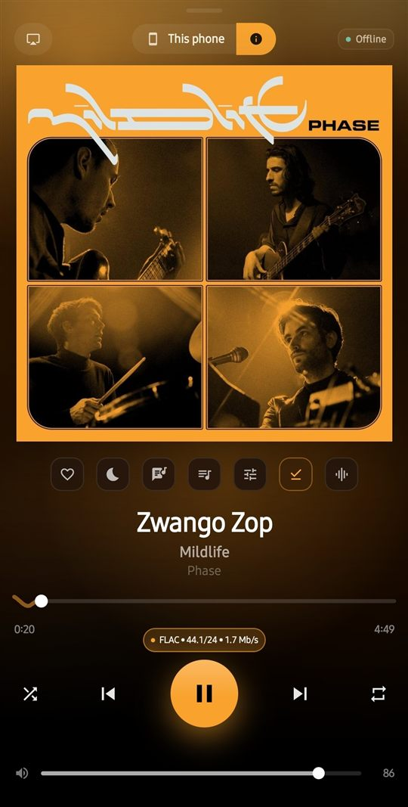
  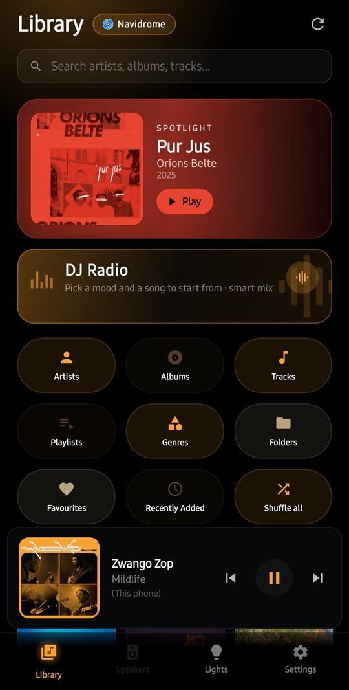
  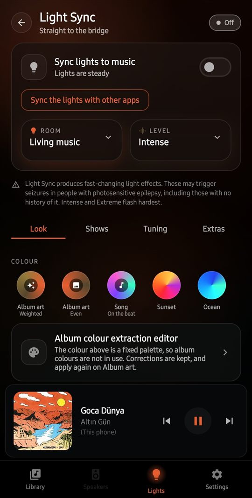

---

## What you get

### Play everything you own, in one place

  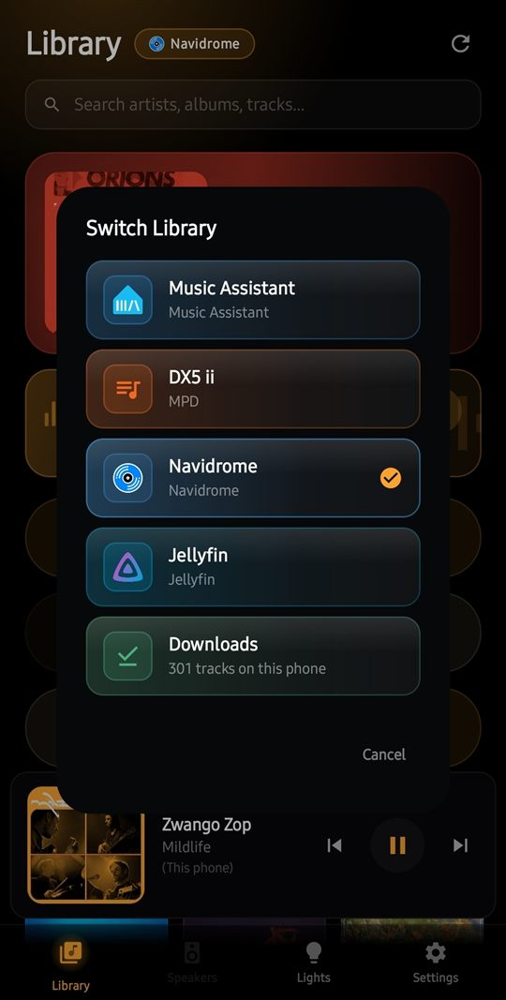
  
  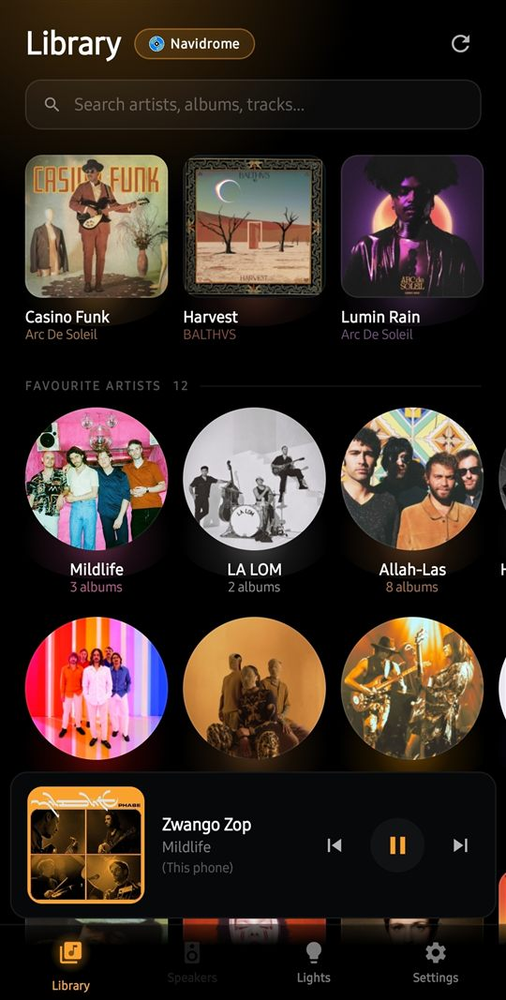
  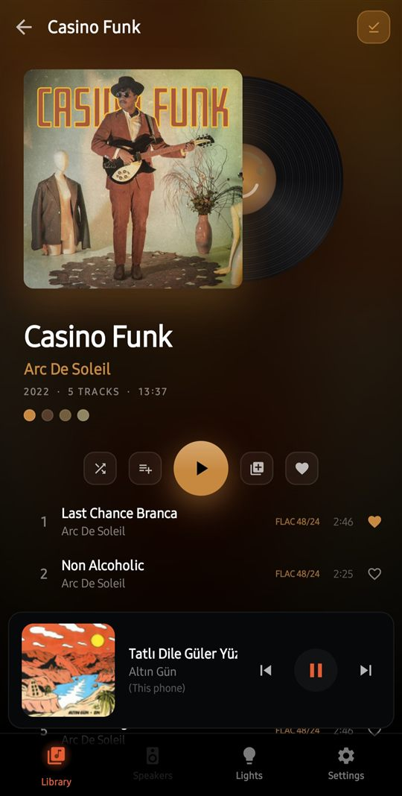

- **Your own libraries.** Navidrome and Subsonic-compatible servers (Gonic, Airsonic, Ampache, Funkwhale, LMS), Jellyfin, Emby, Plex, MPD (moOde, Volumio, piCorePlayer and Mopidy are MPD underneath), Music Assistant and files on the device. Spotify, Qobuz and Tidal accounts and foobar2000 over Beefweb are experimental. Add as many libraries as you like, switch between them from the Library title, or search them all at once. See [libraries](docs/libraries.md).
- **Downloads.** Keep songs, albums and playlists on the phone and play them with no signal. Downloads is a library of its own, with its own Favourites, and playlists stay playlists.
- **A library you can work in.** Artists, Albums, Tracks, Playlists, Genres, Folders, Favourites and Recently Added, a Spotlight album on the home page, and a shuffle-all button. Sort and filter every category, edit playlists, rate tracks and give the category buttons one of five looks. Album pages show the format of every track. A fetch-ahead cache rides out a weak signal, and a separate stream quality can apply on mobile data.

### Sound built for good hardware

  
  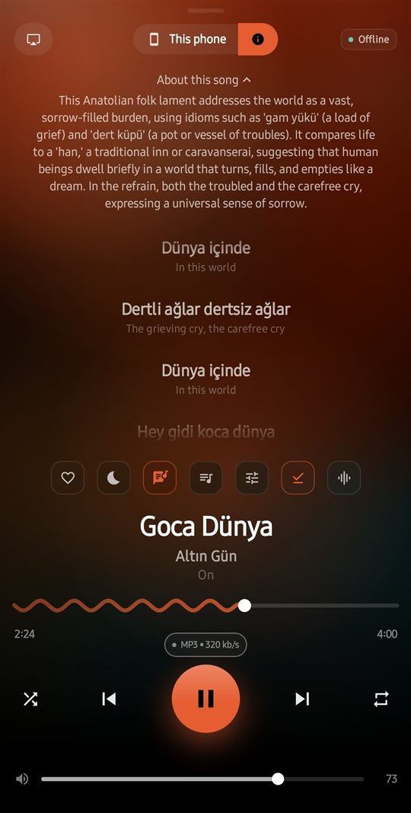

- **Now Playing.** Large artwork with colours taken from the cover, a format badge (codec, sample rate, bit depth, bitrate) on every track, and one-tap buttons for favourite, sleep timer, lyrics, queue, equaliser, the signal path and the visualiser.
- **Equaliser and levelling.** A ten-band or parametric equaliser with AutoEQ headphone import and a curve for each output, gapless playback, a real crossfade on any queue, ReplayGain that lifts quiet masters cleanly, and a loudness scan (EBU R128) for files with no ReplayGain tags. Headphone crossfeed makes headphones sound more like speakers.
- **High resolution output.** High resolution output, and USB bit-perfect (experimental) to a USB DAC. Vinyl, Lo-fi and Old Radio sound modes, and a sleep timer. See [sound](docs/sound.md).
- **See what the audio goes through.** The quality card shows what arrived, every processing step, and each output with Music Assistant's LQ, SQ, HQ or HR grade: every speaker in a group, or the USB DAC with the rate it confirmed.
- **Lyrics that follow the singer.** Words highlight as they are sung, with tap-to-seek. An optional translation sits under each line and runs on the phone, or through your own AI (Ollama, LM Studio, Gemini, OpenRouter or any OpenAI-compatible service), which can add a short "About this song" note on meaning and idiom.

### A Philips Hue light show

  
  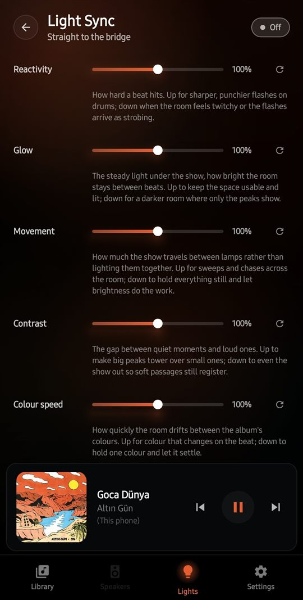
  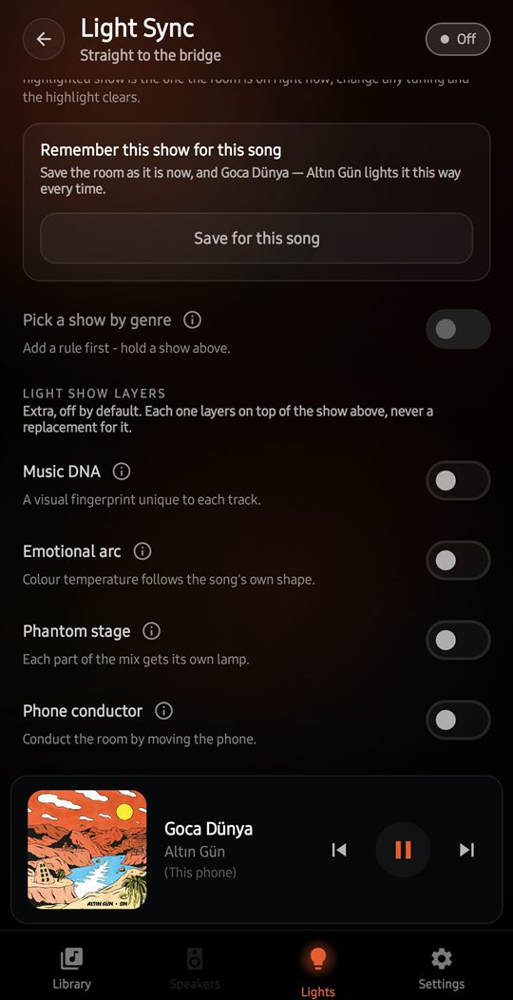

Philips Hue Entertainment, driven straight to the bridge at 60 frames a second from the audio that is playing. Lamp positions come from your entertainment area. The Light Sync page has four tabs:

- **Look.** Pick the room and an intensity level (five levels plus Auto), then the colour: album art (weighted or even), a song-driven palette that changes on the beat, or a fixed palette such as Sunset or Ocean. An editor lets you correct how colours are taken from an album.
- **Shows.** Save the room as a show, remember a show for one song, or pick a show by genre. Shows can be shared.
- **Tuning.** Reactivity, Glow, Movement, Contrast and Colour speed, each with a plain-English description and a reset.
- **Extras.** Four optional layers that sit on top of the show and are off by default: Music DNA (a visual fingerprint of each track), Emotional arc (colour temperature follows the song's shape), Phantom stage (each part of the mix gets its own lamp) and Phone conductor (move the phone to conduct the room).

Also in the show: ambience scenes (fireplace, candlelight, rain on a tin roof, coastal rain, thunderstorm, forest dawn, golden hour, aurora, underwater, light train and fireworks, each built to stay comfortable to sit in), Wake & Sleep (a sunrise alarm that fades the room from deep red to daylight while music fades in, and a sleep timer that dims it to warm amber), and Rhythm Lights, a tap-along game. See [light sync](docs/light-sync.md).

  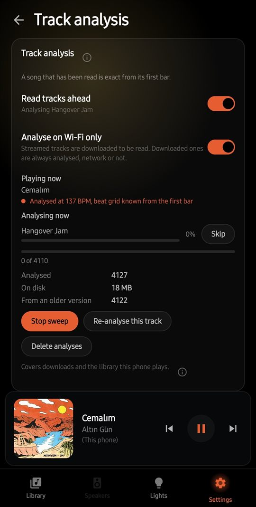

**Track analysis.** CAMusic can read tracks ahead of time, on Wi-Fi only if you like, so a song is exact from its first bar: its tempo, beat grid, sections and drops are known before it plays. Downloaded songs are always analysed. Settings show what has been analysed and let you stop, skip or redo it.

### Music that keeps going

  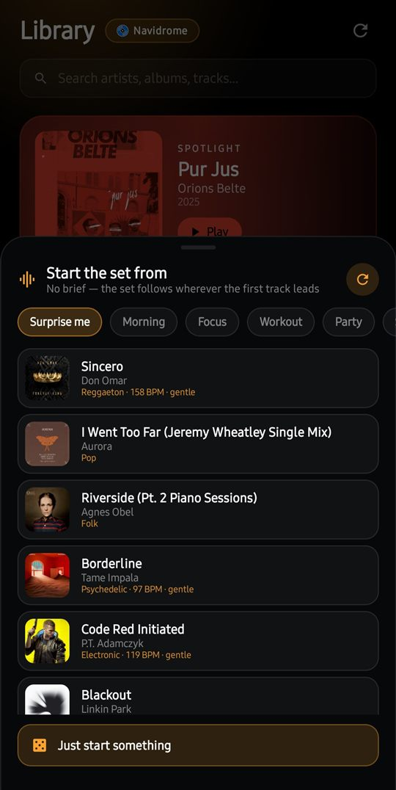
  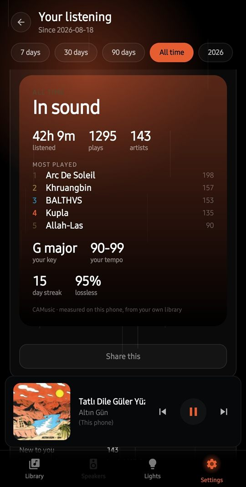

- **DJ Radio and the Set Builder.** Pick a mood (Surprise me, Morning, Focus, Workout, Party and more) and a first song. CAMusic builds and mixes a set by genre, energy, tempo and key, shaped as a warm-up, peak or wind-down. "More like this" works even where a server has none.
- **Rediscover.** Shelves bring back what you played on this day in earlier years, forgotten favourites, albums you have never played and deep cuts from the artists you love.
- **Your listening.** Time listened, plays, top artists, your usual key and tempo, your streak and how much of it was lossless, for a week, a month, 90 days, a year or all time, as a card you can share. Scrobbling to ListenBrainz and Last.fm. See [listening](docs/listening.md).
- **Listening party.** Friends on your Wi-Fi scan a QR code and add songs to your queue from their own phone's browser, with no app and no account. You can approve songs first and let the room vote to skip.

### Multi-room and casting

- **Sendspin and Music Assistant.** CAMusic registers as a Sendspin player, so Music Assistant can stream to the phone like any other speaker, and it stays in step with the other Sendspin speakers in a group song after song. The connection is encrypted and pairs with Music Assistant by PIN. The phone offers every codec at every sample rate it can play, and you choose what it gets in Music Assistant. Home Assistant announcements reach it in the background. As a controller it groups speakers, sets per-player offsets and drives the queue. See [multi-room](docs/multi-room.md).
- **AirPlay output.** Whatever the phone plays itself can go to an Apple TV, a HomePod or an AirPlay speaker from the top-left of Now Playing.

### Everywhere you listen

  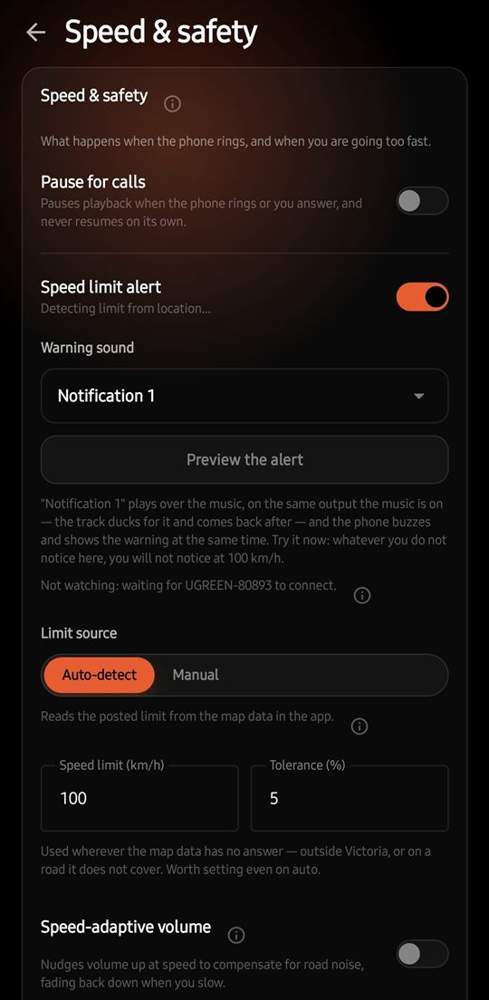
  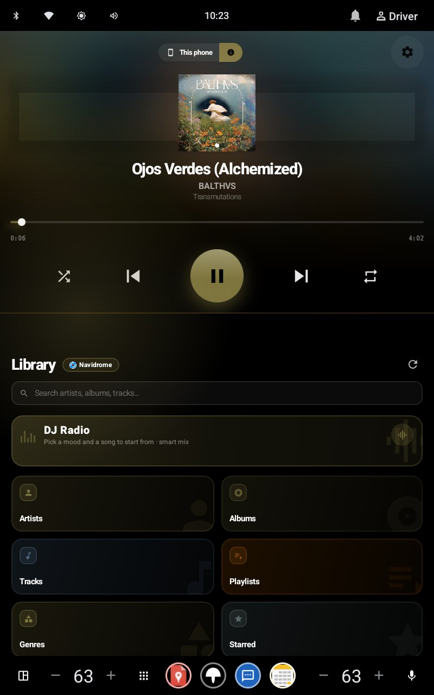
  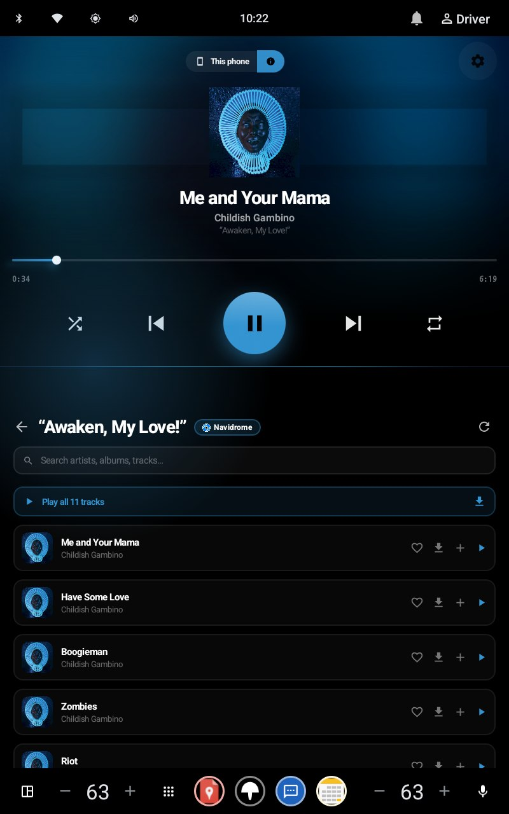

  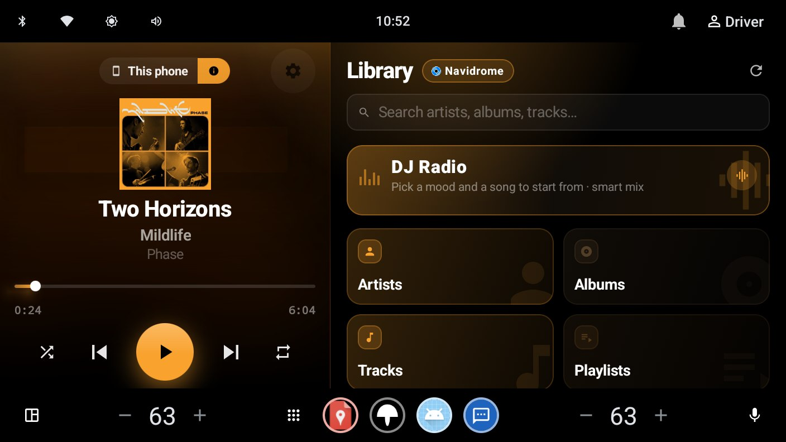

  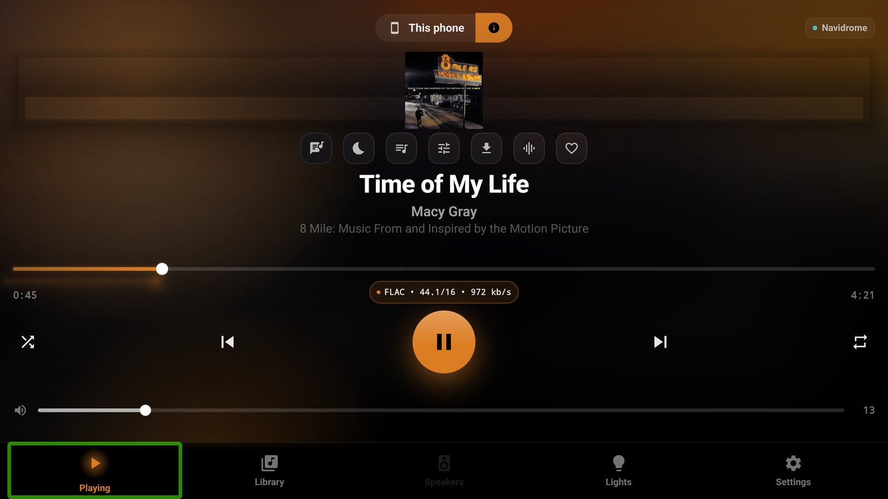
  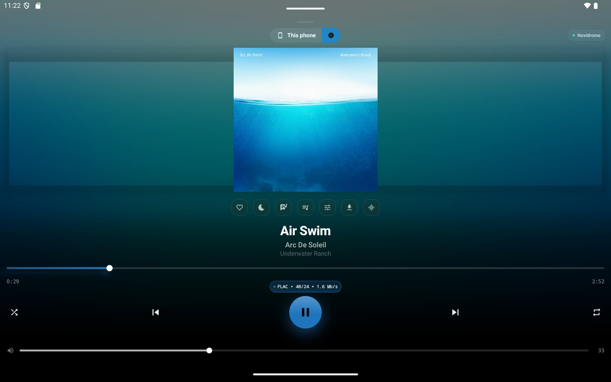

- **Phones, tablets, cars and TVs.** Android Auto, Android Automotive and Android TV, plus an LG webOS app where the TV panel itself becomes the light show. A home screen widget, app shortcuts, and favourite, shuffle and repeat in the system media controls. See [platforms](docs/platforms.md).
- **Speed & safety.** Optionally pause for calls, and get an alert over the music when you pass the speed limit, with a tolerance you set. The limit is read from bundled map data (Victoria, Australia today) or typed in by hand where the map has no answer. Speed-adaptive volume nudges the level up at speed and back down when you slow. Driving mode adds large targets.

### Yours to keep

Your library, history and sign-ins stay on your phone and your own servers. Online lyrics, lyric translation, scrobbling and streaming accounts connect only when you switch them on. The one check that is on from the start asks GitHub once a day whether a new version is out, so the app can tell you, and it can be switched off in About. An encrypted backup carries your servers, playlists, favourites and history to a new phone, and onboarding can restore it.

## Light Sync

Light Sync needs a Hue Bridge v2 with an entertainment area made in the Hue app. CAMusic opens its own DTLS entertainment stream to the bridge and renders **60 frames a second** from the audio it is decoding, with five intensity levels plus Auto, saved and shareable shows, and Rhythm Lights, a tap-along game where your taps are what lights the room. When the sound comes from a speaker in another room, the show follows an offline scan of the track. A [Hue Synco](https://github.com/engabd11/syncoV2) bridge in Home Assistant works too, with a smaller effect set.

Light Sync produces fast-changing light effects. These may trigger seizures in people with photosensitive epilepsy, including those with no history of it. Intense and Extreme flash hardest. Details are in [light sync](docs/light-sync.md#photosensitivity).

## Get started

1. Install the APK from [Releases](https://github.com/engabd11/CAMusic/releases).
2. Open it and follow the onboarding: pick a server or a streaming account, sign in, and optionally pair a Hue bridge by pressing the button on the bridge when asked.
3. Start listening. A server address is the whole of it.

**Requirements:** Android 12 or newer. Everything else is optional and independent of the rest: a Subsonic, Jellyfin, Emby, Plex, MPD, foobar2000 (with Beefweb) or Music Assistant server for the library, or a Spotify Premium, Qobuz or Tidal account; a Hue bridge with an entertainment area for Light Sync; a Music Assistant server for Sendspin multi-room grouping; and an AirPlay receiver for casting.

Android TV has its own `tv` build, made from source. LG webOS has a preview app. Both are covered in [getting started](docs/getting-started.md) and [platforms](docs/platforms.md).

## Next up

- Chromecast, the way AirPlay landed
- Artwork on an AirPlay receiver's own Now Playing
- Wear OS companion
- Audiobookshelf and Kodi as libraries
- Network filesystems: SMB, WebDAV and the major cloud drives
- A live-wired ambient background for the Android TV app, beyond today's fallback palette
- More effects, and more bundled beds

## Documentation

| Document | What it covers |
|---|---|
| [docs/getting-started.md](docs/getting-started.md) | Install, first run, requirements and encrypted backup |
| [docs/libraries.md](docs/libraries.md) | Every library, how each one behaves and what works across all of them |
| [docs/streaming-services.md](docs/streaming-services.md) | Spotify, Qobuz and Tidal accounts (experimental) |
| [docs/sound.md](docs/sound.md) | Equaliser, output modes, USB bit-perfect, ReplayGain, crossfade, DJ Radio and lyrics |
| [docs/light-sync.md](docs/light-sync.md) | The Hue light show, ambience effects and photosensitivity |
| [docs/multi-room.md](docs/multi-room.md) | Sendspin on Music Assistant, and AirPlay output |
| [docs/listening.md](docs/listening.md) | The Set Builder and listening stats |
| [docs/platforms.md](docs/platforms.md) | Android Auto, Android Automotive, Android TV, LG webOS and Driving mode |
| [docs/architecture.md](docs/architecture.md) | Playback, the light engine and the Hue bridge |
| [docs/good-to-know.md](docs/good-to-know.md) | Behaviour that is deliberate |
| [docs/building.md](docs/building.md) | Build from source |
| [docs/release-history.md](docs/release-history.md) | Every shipped feature, by release |
| [docs/README.md](docs/README.md) | The full index, including protocol notes, plans and audits |

## Part of the Cyborg Automation lighting projects

- **CAMusic** is an Android music player made for Sendspin players on Music Assistant, with Hue light shows.
- **[Hue Synco](https://github.com/engabd11/syncoV2)** is a Home Assistant integration that lights Hue to the music of any media player.
- **[Hue Ghost](https://github.com/engabd11/HueGhost)** lights films, games and apps from your PC.

Use one or all three. They can share an entertainment area by taking turns, because an area streams from one app at a time. See all three on the [open source lighting page](https://cyborgautomation.com.au/pages/oss-lighting).

## Contributing

See [CONTRIBUTING.md](CONTRIBUTING.md). Bug reports with a logcat are welcome, and so is anything that makes the light show look better in a real room.

## Credits

CAMusic got through its first month of development with the help of two projects that were already solving the same problems in the open: [Music Assistant](https://github.com/music-assistant/server) and [MassDroid](https://github.com/sfortis/massdroid_native) by Dionysis Fortis. Third-party material shipped in the app, and its licences, are listed in [docs/attributions.md](docs/attributions.md).

## Licence

Apache License 2.0. See [LICENSE](LICENSE).
